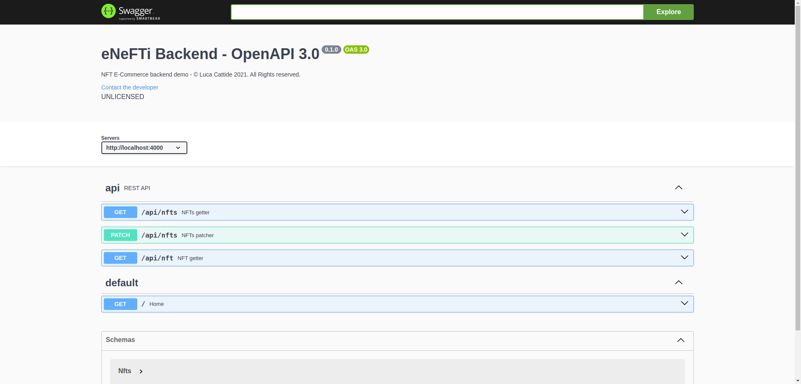
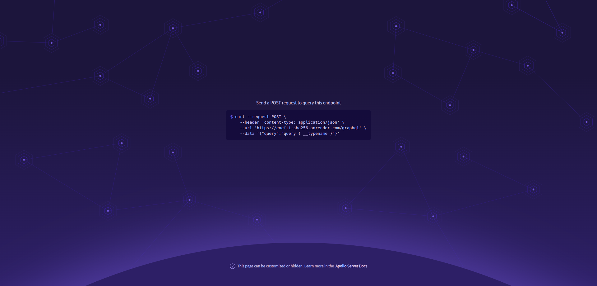

# eNeFTi — Backend

NFT e-commerce API server built with **Node.js**, **Express 4**, **Apollo Server 4 (GraphQL)**, **TypeScript 5.9**, and **MongoDB Atlas (Mongoose 8)**.

[](https://github.com/lc-2025/enefti/actions/workflows/ci.yml)
[](https://github.com/lc-2025/enefti/actions/workflows/cd.yml)

**Live API:** [enefti-sha256.onrender.com](https://enefti-sha256.onrender.com)

---

## Overview

The **eNeFTi Backend** exposes dual **GraphQL** and **REST** APIs to manage digital collectible catalogs, filtering, wishlist/cart persistence, and simulated checkout history backed by a **MongoDB Atlas** cluster.

### Core Capabilities

- **Dual API Layer (GraphQL & REST):** Serves typed GraphQL queries and mutations via **Apollo Server 4** (`/graphql`) alongside versioned REST endpoints (`/docs/rest`) documented with **Swagger UI**.
- **Production-Hardened Express Middleware:** Enforces security and performance best practices using **Helmet**, **CORS**, **express-rate-limit**, **express-mongo-sanitize**, **Joi** payload validation, and **compression**.
- **Automated Catalog Seeding:** Includes a TypeScript seeding pipeline (`src/seed.ts`) integrated with the **CoinGecko API** to populate the database with 100 realistic NFT product records.
- **Containerized Cloud Delivery:** Built with **Docker / Docker Compose**, published to **GitHub Container Registry (GHCR)**, and deployed to **Render** via automated GitHub Actions workflows.

---

## API Documentation & Previews

- **REST API (Swagger UI):** [enefti-sha256.onrender.com/docs/rest](https://enefti-sha256.onrender.com/docs/rest)
- **GraphQL API (Apollo Studio):** [enefti-sha256.onrender.com/graphql](https://enefti-sha256.onrender.com/graphql)




---

## Tech Stack

- **Runtime & Framework:** Node.js, Express 4, TypeScript 5.9
- **GraphQL & API Docs:** Apollo Server 4 (`@apollo/server`, `@apollo/subgraph`), GraphQL 16, Swagger UI Express
- **Database & Validation:** MongoDB Atlas, Mongoose 8, Joi 18
- **Security & Performance:** Helmet 8, CORS, express-rate-limit 8, express-mongo-sanitize, Compression
- **External Integrations:** Axios, CoinGecko API
- **Code Quality & Testing:** Jest 29, Supertest 7, ESLint 9, Prettier 3, Husky
- **Containerization & Hosting:** Docker, Docker Compose, GitHub Actions, GitHub Container Registry (GHCR), Render

---

## Getting Started

### Prerequisites

- **Node.js** (LTS) and **npm**
- **MongoDB** instance (local or **MongoDB Atlas** cluster)
- **Docker & Docker Compose** (optional, for containerized execution)

### Environment Configuration

Create your local environment file (`.env` / `.env.*`) in the `backend/` workspace based on `.env.dist`:

```bash
cp .env.dist .env
```

Configure the MongoDB connection string, CORS origins, rate-limit thresholds, and CoinGecko API settings prior to starting the server.

### Database Seeding

Populate a MongoDB cluster with 100 mocked NFT records generated via [src/seed.ts](./src/seed.ts) using the [CoinGecko API](https://www.coingecko.com/en/api):

```bash
npm run seed
```

### Development & Build Commands

Run commands from the `backend/` directory (or via workspace scripts from the repository root):

- **Start development server (`nodemon`):**

```bash
npm run dev
```

- **Run code formatter:**

```bash
npm run lint
```

- **Build TypeScript output & copy GraphQL schema:**

```bash
npm run build
```

- **Start production server:**

```bash
npm run start
```

---

## Testing

- **Run unit & integration tests in watch mode:**

```bash
npm run test
```

- **Run unit & integration tests in CI mode:**

```bash
npm run test:ci
```

---

## Docker & Deployment

### Local Container Execution

- **Build image and start container in detached mode:**

```bash
docker-compose up -d --build
```

- **Stop running container:**

```bash
docker-compose stop
```

### Production CI/CD Pipeline

Automated **GitHub Actions** workflows (`ci.yml` / `cd.yml`) lint, test, compile, and containerize the server into a **Docker** image pushed to **GitHub Container Registry (GHCR)** and deployed to **Render** at [enefti-sha256.onrender.com](https://enefti-sha256.onrender.com).

---

## Copyright & Disclaimer

**All Rights Reserved (`UNLICENSED`).** The source code in this repository is the original work of the author and is published solely for portfolio demonstration and technical evaluation purposes. No license is granted for commercial use, redistribution, or derivative works.

All third-party trademarks, logos, digital asset artwork, and external API references (including CoinGecko) displayed in the application or preview media belong to their respective owners. The author claims no ownership or affiliation with those entities.
