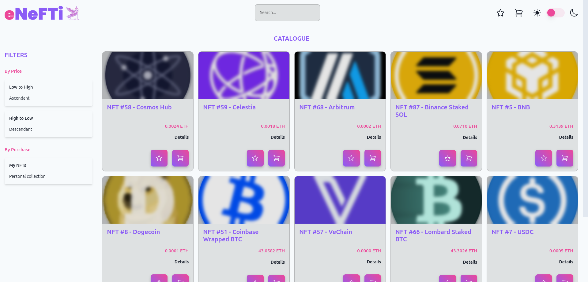
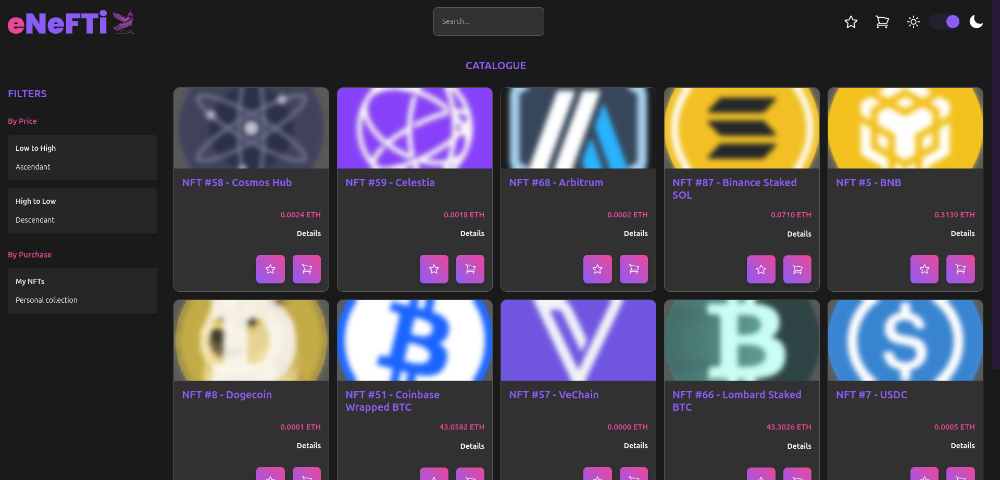

# eNeFTi — Frontend

NFT e-commerce storefront application built with **Next.js 16**, **React 19**, **TypeScript 5.9**, **Apollo GraphQL**, **Redux Toolkit**, and **Tailwind CSS v4**.

[](https://github.com/lc-2025/enefti/actions/workflows/ci.yml)
[](https://github.com/lc-2025/enefti/actions/workflows/cd.yml)

**Live Demo:** [enefti-demo.vercel.app](https://enefti-demo.vercel.app)


---

## Overview

The **eNeFTi Frontend** provides a responsive digital collectibles storefront that connects to the dedicated GraphQL/REST backend API to browse paginated NFT catalogs, filter assets, manage persistent cart and wishlist state, and complete simulated checkout flows.

### Core Capabilities

- **Typed GraphQL Data Layer:** Uses **Apollo Client** (`@apollo/client` & `@apollo/experimental-nextjs-app-support`) paired with **GraphQL Code Generator** (`graphql-codegen`) for end-to-end type-safe queries and mutations.
- **Client State & Persistence:** Manages shopping cart, wishlist, and purchase history state with **Redux Toolkit** (`@reduxjs/toolkit`, `react-redux`).
- **Accessible & Animated UI:** Built with **Tailwind CSS v4**, **Sass**, **Headless UI**, **Heroicons**, and **Motion**, supporting automatic system-detected Light and Dark themes.
- **Cold-Start Resilience & UX:** Handles backend cold-start states gracefully with non-blocking loading feedback while fetching catalog data.

---

## Visual Previews

- **Light Theme:** 
- **Dark Theme:** 

---

## Tech Stack

- **Framework & Core:** Next.js 16 (`--turbopack`), React 19, TypeScript 5.9
- **Data & State Management:** Apollo Client 3, GraphQL 16, GraphQL Codegen, Redux Toolkit 2
- **Styling & UI Components:** Tailwind CSS v4, Sass, Headless UI, Heroicons, Motion 12
- **Code Quality & Linting:** ESLint 9, Prettier 3 (`prettier-plugin-tailwindcss`), Stylelint 16, Husky
- **Testing:** Jest 29, React Testing Library 16, Cypress 14 (`@testing-library/cypress`)
- **CI/CD & Hosting:** GitHub Actions, Docker, Vercel

---

## Getting Started

### Prerequisites

- **Node.js** (LTS) and **npm**
- Running instance of the [eNeFTi Backend](../backend/README.md) (or configured remote API endpoint)

### Environment Configuration

Create your local environment file (`.env` / `.env.local`) in the `frontend/` workspace based on `.env.dist`:

```bash
cp .env.dist .env.local
```

Configure the required variables for API communication and end-to-end testing before starting the development server.

### Development & Build Commands

Run commands from the `frontend/` directory (or via workspace scripts from the repository root):

- **Start development server (Turbopack):**

```bash
npm run dev
```

- **Generate GraphQL TypeScript types:**

```bash
npm run build:types
```

- **Run linter and formatting checks:**

```bash
npm run lint
```

- **Build production bundle:**

```bash
npm run build
```

- **Start production server:**

```bash
npm run start
```

---

## Testing

- **Run unit & integration tests in watch mode:**

```bash
npm run test
```

- **Run unit & integration tests in CI mode:**

```bash
npm run test:ci
```

- **Open Cypress interactive E2E test runner:**

```bash
npm run cypress:open
```

---

## Deployment

Continuous integration and delivery are automated via **GitHub Actions** (`ci.yml` / `cd.yml`), running linting, type checks, unit/integration tests, and production builds prior to deploying the frontend artifact to **Vercel** at [enefti-demo.vercel.app](https://enefti-demo.vercel.app).

---

## Copyright & Disclaimer

**All Rights Reserved (`UNLICENSED`).** The source code in this repository is the original work of the author and is published solely for portfolio demonstration and technical evaluation purposes. No license is granted for commercial use, redistribution, or derivative works.

All third-party trademarks, logos, digital asset artwork, and external API references displayed in the application or preview media belong to their respective owners. The author claims no ownership or affiliation with those entities.
